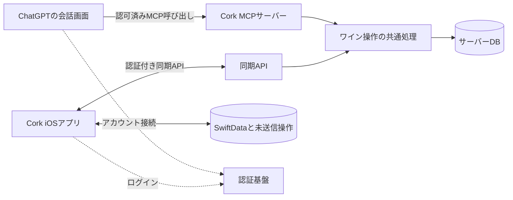

# Cork × ChatGPT 連携 実装計画書

調査日: 2026-11-01（日本時間）  
状態: 分割PRで実装中。保存復旧、MCPサーバー、認証検証、永続同期の実装と自動テストを進めている。実アカウントでの接続検証・クラウド構築は未実施。

## 1. 結論と目的

**ChatGPTの画面からCorkのワインデータを検索・登録・更新する連携は実現可能。**

ChatGPTにCork用のMCPサーバーを接続し、Corkアプリと同じデータを操作させる。OpenAIの現在の公式ドキュメントでは、MCPで機能を公開するプラグインと、必要に応じて追加するChatGPT内のWeb UIが案内されている。[公式: MCPとUIのクイックスタート](https://developers.openai.com/plugins/build/app-quickstart)

今回のSDK導入先は、主に新設するバックエンド。iOSアプリにSDKを追加するだけでは、ChatGPTから端末内のSwiftDataを操作する経路はできない。Cork側にはアカウント接続と双方向同期を実装する。

実現したい会話の例:

- 「Corkにある、まだ開けていない赤ワインを見せて」
- 「この2021年のボトルを開栓済みにして」
- 「昨日飲んだワインに評価4、香りはベリー、という記録を追加して」
- 「買った白ワインを1本登録して」
- 「私の好みに合って、魚料理に合わせやすいものを在庫から教えて」

最後の例は、Corkが在庫・味の記録を返し、ChatGPTがその情報から提案する。提案内容を実測済みのテイスティングや在庫の事実として保存しない。

## 2. 現在のプロジェクトで確認したこと

以下はこのリポジトリの実装を読んで確認した内容。

| 項目 | 現状 | 連携への影響 |
| --- | --- | --- |
| アプリ | SwiftUI / Swift 6 / iOS・iPadOS 26以上 | iOSの画面・データ処理を拡張する |
| データ保存 | SwiftDataとApplication Support内のメディアファイル | サーバーから直接アクセスできる構成は存在しない |
| データ操作 | `CellarStore` → `CellarRepository` | ローカル操作の記録とリモート変更の適用をこの境界に追加する |
| モデル | ワイン、個別ボトル、状態履歴、テイスティング、ペアリング | 既存のUUID・項目・状態を同期契約の基礎にできる |
| 状態 | `owned` / `opened` / `finished` | 日付・残量・状態履歴も一緒に更新する必要がある |
| バックアップ | 画像を含むJSONの書き出し・読み込み | 移行前の保全に使える。既存IDの更新をしないため、そのまま同期処理には使えない |
| 設定画面 | 「データはこの端末に保存」「ネットワーク接続は必要ありません」と表示 | 連携を有効にした場合の保存先・送信項目・同期状態を表示する必要がある |
| サーバー・認証・同期 | 該当する実装なし | 新規実装が必要 |
| スキーマ | V1のみ。移行ステージなし | 同期情報を保存するV2と移行検証が必要 |

主な確認箇所: `project.yml`、`Cork/App/CorkApp.swift`、`Cork/App/CellarStore.swift`、`Cork/Data/CellarRepository.swift`、`Cork/Data/SwiftDataModels.swift`、`Cork/Data/CellarArchive.swift`、`Cork/Domain/WineDomain.swift`、`Cork/Features/RootView.swift`。

特に、`importArchiveData` は既存UUIDをスキップする追加型の処理で、更新・削除・競合解決を扱わない。バックアップの往復だけでは今回の目的を満たせない。

## 3. 採用する構成案



MCPサーバーと同期APIは、最初は1つのバックエンド内に実装する。両方が共通の業務処理とDBを使い、同じ状態変更ルールを適用する。

| 要素 | 採用案 | 理由 |
| --- | --- | --- |
| バックエンド | TypeScript / Node.js | 公式のMCPサーバー例に沿って実装できる |
| MCP | `@modelcontextprotocol/sdk`、Streamable HTTP、`/mcp` | ChatGPTへツールを公開する |
| 入出力定義 | `zod`、バージョン付きJSON契約 | Swift側とサーバー側の型・制約を一致させる |
| サーバーDB | PostgreSQL | 所有者分離、更新競合の検知、操作の一括確定を扱う |
| 認証 | OAuth 2.1に対応した認証基盤 | iOSとChatGPTを同じCorkユーザーに結び付ける |
| iOS通信 | `URLSession` + `async/await` | Cork用同期APIに接続する |
| ChatGPT内の専用UI | 初期版は会話とツール結果。後続でMCP Apps UI | データの操作経路を先に完成させる |

MCPのSDKとHTTP公開方法は[公式: MCPサーバーの構築](https://developers.openai.com/plugins/build/mcp-server)を参照。専用UIを追加する段階では `@modelcontextprotocol/ext-apps` を使う。[公式: UIクイックスタート](https://developers.openai.com/plugins/build/app-quickstart)

この設計では、Corkサーバー自身はOpenAIの推論APIを呼ばないため、Cork用のOpenAI APIキーは不要。費用はサーバー・DB・認証基盤とChatGPT側の利用条件で検討する。将来Corkアプリ内にAI推論機能も追加する場合は、別のAPI導入として扱う。

## 4. 初期リリースの対象

初期リリースは、本人の1アカウント・1セラーで検証する。バックエンドは最初からユーザーごとにデータを分離する。

対象:

- 在庫検索、ボトル詳細、味の傾向の参照。
- テキスト情報によるボトル登録。
- ボトルの保管場所・メモ・残量の更新。
- 開栓・飲了などの状態変更。
- テイスティングと料理ペアリングの追加。
- 既存データの初回アップロードと、その後の双方向同期。
- Corkアプリの既存操作による削除も同期。ChatGPTには初期版で削除ツールを公開しない。

後続に回すもの:

- 写真・ラベル・3D資産のクラウド保存とChatGPT内表示。
- ChatGPT内のボトルカードや編集フォーム。
- 銘柄の基本情報の編集、複数セラー・共有・家族利用。
- プラグインディレクトリへの一般公開。

写真は初期版では端末に残す。ChatGPTで作成したボトルには写真がなくても表示できるようにする。OCRの生テキスト、購入価格、写真は初期の同期項目に含めず、クラウドへ送る項目を接続画面で明示する。保管場所・メモ・テイスティング本文は、今回の操作対象として同期する。

## 5. ChatGPTに公開するツール案

| ツール | 用途 | 主な入力 | 主な出力 | 権限 |
| --- | --- | --- | --- | --- |
| `search_bottles` | 在庫の検索・絞り込み | 検索語、状態、種類、産地、年、ページカーソル | ボトルID、名前、年、状態、次ページ | `cellar:read` |
| `get_bottle` | 操作対象の詳細確認 | `bottle_id` | 詳細、テイスティング・ペアリング、`version` | `cellar:read` |
| `get_taste_profile` | 好みの傾向の確認 | なし | 集計値、記録数、集計時点 | `cellar:read` |
| `get_sync_status` | データの反映時点の確認 | なし | サーバー変更時点、端末の最終同期時点 | `cellar:read` |
| `create_bottle` | ワインと個別ボトルの登録 | 名前、種類、任意の産地・年など、`operation_id` | 作成ID、確定値、`version` | `cellar:write` |
| `update_bottle` | 保管場所・メモ・残量の更新 | ID、変更項目、`expected_version`、`operation_id` | 更新後の値と`version` | `cellar:write` |
| `set_bottle_state` | 所持・開栓中・飲了の変更 | ID、状態、`expected_version`、`operation_id` | 状態、日付、残量、`version` | `cellar:write` |
| `add_tasting` | 飲用記録の追加 | ID、評価、タグ、メモ、飲用日時、`operation_id` | 記録ID、更新後の集計 | `cellar:write` |
| `add_pairing` | 料理との相性の記録 | ID、料理名、相性スコア、メモ、`operation_id` | ペアリングID | `cellar:write` |

実装時に次の契約を確定する。

- 一覧は初期20件、最大100件。全件や全履歴を毎回会話に返さない。
- ユーザーの特定は認証情報から行い、モデルが指定する `user_id` は受け付けない。
- 操作対象はUUIDで特定。同名・同年のボトルが複数ある場合は候補を提示する。
- `CellarEntry.id` は個別ボトルのIDとして扱い、`wineID` と区別する。
- 評価は未入力を許容し、入力時は1〜5。味の各指標は0〜5、ペアリングは1〜5、残量は0〜100。未指定の値を推測して埋めない。
- 日時はタイムゾーン付きで扱い、曖昧な飲用日は確認する。状態変更時刻は明示指定がなければサーバー時刻。
- 更新フィールドの省略は「変更なし」、明示的な `null` は「クリア」として区別する。
- 成功結果に `committed_at` と `version` を返す。同期状況は「サーバー保存済み」「端末は次回同期時に反映」を区別する。
- `NOT_FOUND`、`VALIDATION_ERROR`、`VERSION_CONFLICT`、`AUTH_REQUIRED`、`FORBIDDEN` を区別し、失敗時は書き込みを確定しない。

ツール名・入出力・権限・副作用を明示する設計は[公式: ツールの定義](https://developers.openai.com/plugins/plan/tools)に沿う。読み取りツールと書き込みツールには実際の動作に合った注釈を付け、ChatGPT側の確認挙動を接続テストで検証する。注釈だけを認可の根拠にはしない。[公式: MCPサーバーの注釈](https://developers.openai.com/plugins/build/mcp-server#tool-annotations-and-elicitation)

## 6. アカウント接続と認証

接続の流れは、Corkアプリでアカウントを作成・ログイン → 同期を有効化 → ChatGPTにCorkのMCPを追加 → 同じCorkアカウントで認可、の順とする。

認証の受け入れ条件:

- ChatGPT向けにOAuth 2.1 / Authorization Code + PKCEを提供する。
- protected resource metadata、認可サーバーのmetadata、`resource` の受け渡しに対応する。
- クライアント登録は認証基盤の対応を確認し、CIMDを優先候補とする。DCRまたは事前登録クライアントの採用可否も最初の接続検証で確定する。
- リクエストごとにトークンの署名・issuer・audience・期限・scopeと対象レコードの所有者を検証する。
- ツールごとに認証要件を公開し、未接続・期限切れ時に再認可へ進めるエラーを返す。
- 読み取りだけの接続から開始でき、書き込みには追加の権限を求める。

これらのOpenAI側の要件は[公式: MCPサーバーの認証](https://developers.openai.com/plugins/build/auth)に基づく。

実装上は、iOSのトークンをKeychainに保存し、ユーザーと端末の対応を管理する。連携解除でChatGPT向けの認可と同期通信を停止できるようにする。サーバー保存データの削除は連携解除とは別の機能とし、挙動を画面に表示する。別アカウントへの切り替え時は、以前のデータや未送信操作が新アカウントに送られないよう、ローカルの同期領域を分離する。

## 7. データ同期と更新ルール

### 正とするデータ

連携しない場合は現状どおり端末内のデータで動作する。連携後は、同期対象の確定状態をサーバーで管理し、SwiftDataに表示用データと未送信操作を保持する。購入価格・画像などの非同期項目は端末で管理する。未送信の変更をサーバーの値で黙って消さない。

実装では、ボトルとその記録を1つの集約として同期する。iOSの編集は集約全体をversion付きで更新し、ChatGPTには用途別のツールを公開する。同期情報はV2で追加する単一のjournalモデルに格納し、V1の既存モデルの項目は変更しない。初期版は保存領域を1アカウント・1サーバーに固定し、別の接続先への切り替えは拒否する。

### 永続ストアの起動と復旧

現在の `CorkApp.swift` は、永続ストアを開けない場合にメモリ内ストアへ切り替える。同期導入時はこの挙動を変更し、ストアの状態を「読み込み中・移行中・利用可能・復旧待ち」として扱う。

- `CellarStore` と `SyncCoordinator` は、永続ストアの読み込み・移行が完了してから起動する。編集・初回アップロード・通常同期を開始できるのは「利用可能」の場合だけとする。
- 移行や読み込みに失敗した場合は復旧画面を表示し、既存のストア・画像・未送信操作を保ったまま再試行できるようにする。空のストアを作成して起動成功と扱わない。
- メモリ内ストアの利用はテスト・プレビューに限定する。本番の復旧処理で既存ストアを自動削除しない。
- 復旧後は、保存済みの移行進捗・未送信操作・差分カーソルを読み込み、最後に確定した処理から再開する。

### 初回移行

1. 永続ストアが利用可能で、現行形式でバックアップを保存できる状態を確認する。
2. 対象件数と送信項目を表示して同期を有効化する。
3. ローカル書き込みを直列化した境界 `S` で、変更追跡の開始と固定スナップショットの作成を行う。移行ID・境界・スナップショット・送信進捗を永続化し、境界以降の変更が記録から漏れる時間を作らない。
4. スナップショット内のワイン・ボトル・テイスティング・ペアリング・状態履歴を、既存UUIDを保って分割送信する。所有者と移行ID・エンティティIDで照合し、中断後も同じスナップショットと移行IDで再開する。
5. 移行中の編集・追加・削除は、ローカル変更と同じ保存処理で未送信キューへ記録する。スナップショットを書き換えず、サーバーへの操作送信はスナップショットの受け入れ後に行う。
6. サーバー側に既存データがある場合はマージ手順に進む。名前だけで同一ワインと決めたり、既存データを一括置換したりしない。スナップショットとの照合対象を固定し、その後のサーバー変更もversionで競合検知する。
7. スナップショットの受け入れ後、未送信キューの到達点 `H` を永続化し、境界 `S` 以降から `H` までの変更を順に反映する。`H` より後の編集も記録し続け、通常同期へ引き継ぐ。
8. スナップショットと `H` までの変更について、件数・UUID・参照関係・同期項目の値・確定versionを照合して通常同期へ切り替える。件数が変わらないメモ編集も照合対象にする。失敗時はローカルデータと進捗を保ち、キューは成功応答の永続化後に処理済みとする。

### 通常同期

- ローカルの変更と未送信操作の追加を、同じ保存処理で永続化する。
- 起動時・フォアグラウンド復帰時・変更保存後・手動更新時に同期する。
- `operation_id`、対象ID、`base_version`、変更内容を送信し、サーバーが確定した結果を受け取る。
- 差分取得はサーバーで確定した変更ログのカーソルを使い、端末の時計だけに依存しない。確定順と端末への保存単位は後述の条件を満たす。
- 各レコードの `version` で競合を検知。競合時は最新状態と未送信の内容を保持してCork上で解決する。ChatGPTからの競合は再取得してユーザーに説明する。
- 同じ操作IDと同じ内容の再送は同じ結果を返す。同じ操作IDで内容が違う場合は拒否する。新規作成・テイスティング・ペアリングの重複登録を防ぐ。
- 端末の既存削除操作は削除記録を同期し、古い端末データによる復活を防ぐ。
- バックアップの読み込み・一括追加も同期の変更検出対象に含める。
- 通信断や再起動でキューを失わず、再試行できるようにする。

### 差分カーソルの確定順と保存単位

- 初期版はセラー単位のDB行ロックをトランザクション完了まで保持し、変更の確定順を直列化する。対象データの変更、変更ログ、ログ位置の更新、操作IDに対応する成功結果を同じトランザクションで保存する。MCPと同期APIの両方に適用する。
- カーソルはこの確定済みログ位置を指す。単なる発行順の連番を取得済み位置として使わず、未確定の変更を飛び越えてカーソルを進めない。
- 差分取得開始時に確定済みの上限位置を固定し、ページングはその上限までとする。上限より後の変更は次の取得で扱う。各ページには変更一覧・次カーソル・残りページの有無を返す。
- iOSは、1ページ分の変更・確定済み状態・次カーソルを同じSwiftDataのトランザクションで保存する。保存失敗時はすべてロールバックし、前のカーソルから再取得する。
- 操作送信の成功応答も、確定version・確定済み状態・キューの処理済み化を同時に保存する。保存前にアプリが終了した場合は、同じ操作IDと同じリクエストで再送する。サーバーは重複判定をversion照合より先に行い、以前の成功結果を返す。

例えば変更10が未確定のまま変更11だけを端末へ返し、取得済み位置を11へ進めることを禁止する。並行更新とトランザクションの中断を使って、この条件を検証する。

### 同じボトルへの連続編集

- キューにはボトル単位の操作順序を保存し、同じボトルに対して同時に送信中となる操作は1件にする。新規作成の完了後に編集・記録追加を送るなど、参照先が先に確定する順序も保つ。
- 後続操作の `base_version` は、先行操作の成功応答を永続化してから確定する。初めて送信する直前にリクエスト内容を永続化し、送信後の再試行では操作ID・version・内容を変更しない。
- 自分の先行操作の成功によるversion更新と、ChatGPTや別端末による競合を区別する。外部変更で競合した場合は自動でversionを差し替えて上書きせず、後続操作を保留して解決する。解決後の変更は新しい操作IDで送る。
- ローカルでは「サーバーで確定済みの状態」と「未送信・送信中の変更」を分離する。画面には確定済み状態へ保留中の変更を順に重ねた値を表示し、先行操作の応答や差分取得で新しい編集を消さない。

例えばversion 5のボトルにオフラインで「メモA」「メモB」の順に編集した場合、最初の操作をversion 5で送り、成功後のversion 6を保存してから次を送る。最初の成功応答が届いても、画面のメモBは維持する。その間にChatGPTがversion 7へ更新していた場合は、次の送信を競合として扱う。

### 操作の一貫性

状態変更は、ボトル状態・開栓/飲了日時・残量・履歴を1回の処理で確定する。テイスティング追加は件数・評価集計・タグ・Taste Profileとの整合を検証する。サーバー側の変更をSwiftDataへ適用するときは再送用の操作を作らず、同期のループを防ぐ。

現行の `updateBottle` は渡された項目をまとめて設定するため、部分更新用の変換・適用処理を追加する。既存処理へ欠落項目を `nil` として渡して、保管場所やメモを消さないようにする。

### アプリを閉じている間

ChatGPTはサーバー上の在庫を参照・更新する。端末が未起動・オフラインの間もサーバー保存は完了できる。Cork画面への反映は次回の同期時とし、端末が閉じている間の即時反映を初期版の要件にしない。ChatGPTへ返す最終同期日時は、端末から最後に報告された時点であり、現在の端末内の未送信変更を把握した値ではない。

## 8. 変更するファイルと新規モジュール

以下は予定する配置。新規ファイルはまだ作成していない。

| 箇所 | 予定する変更 |
| --- | --- |
| `Cork/App/CorkApp.swift` | 永続ストアの起動状態と復旧導線、利用可能になってからのサービス生成、復帰時の同期開始 |
| `Cork/App/CellarStore.swift` | 同期状態の公開、データ更新後の表示更新 |
| `Cork/Data/CellarRepository.swift` | 安定ID付きの作成、操作キューの同時保存、差分適用、削除記録の作成 |
| `Cork/Data/SwiftDataModels.swift` | V1の定義固定、V2と移行の定義 |
| 新規 `Cork/Data/SyncModels.swift` | ユーザー別の同期状態・確定済み状態・version・順序付き未送信操作・移行スナップショットと進捗・競合情報 |
| 新規 `Cork/Sync/` | `SyncClient`、`SyncCoordinator`、同期DTO、ボトル単位の送信制御、差分とカーソルの一括保存 |
| 新規 `Cork/Auth/` | ログイン、トークン更新、Keychain管理、ログアウト |
| `Cork/Features/RootView.swift` | 設定画面にアカウント接続・送信項目・最終同期・再試行・解除を追加 |
| 新規 `Cork/Features/SyncConflictView.swift` | 競合した端末側/サーバー側の内容を表示して解決 |
| 新規 `Cork/Features/StorageRecoveryView.swift` | 永続ストアを開けない場合のエラー表示と再試行 |
| `CorkTests/`、`CorkUITests/` | 同期・認証状態・移行・画面の回帰検証 |
| 新規 `server/cork-service/` | MCP、同期API、認可、ワイン操作、DBマイグレーション、テスト |
| 新規 `contracts/` | API・DTO・ツール契約とSwift/TypeScript共通の検証用データ |
| `project.yml`、`README.md` | 必要な構成設定と開発・接続手順を追記 |

現状の `CorkSchemaV1.models` は `CorkSchema.models` を参照している。新しいモデルをその一覧に足す前に、旧スキーマを固定し、既存ストアから移行できる構造へ整理する。同期メタデータを既存のJSONバックアップに混ぜず、バックアップ読み込み時はアカウントへ再同期する扱いにする。既存画像のID・ローカル参照は、画像を持たないサーバーDTOで消さない。

サーバー内の境界:

```text
server/cork-service/
  src/mcp/          ChatGPT向けツール
  src/http/         iOS向け同期API
  src/auth/         認証情報の検証と所有者の確定
  src/domain/       作成・部分更新・状態変更・記録・集計
  src/db/           データ取得、確定順の制御、操作結果と差分履歴の一括保存
  migrations/      DBのスキーマ更新
  tests/           契約・認可・同期の検証
```

同期APIは、初回移行開始/分割送信/完了、操作の送信、カーソルによる差分取得、同期状態取得を持つ。詳細なURL・JSON契約はフェーズ1で固定し、MCPと同期APIは同じ業務処理を呼ぶ。

## 9. 実装順と概算工数

1人で実装する場合の提案値。既存機能の大幅修正・一般公開審査・認証基盤契約の待ち時間は含めない。

| フェーズ | 作業 | 完了条件 | 目安 |
| --- | --- | --- | --- |
| 0: 接続確認 | ダミーデータのMCPを作り、対象アカウントから読取・書込・OAuthを試す | 実際のChatGPTで検索と状態変更が動き、必要な権限と利用画面を確認 | 1〜2人日 |
| 1: サーバー基盤 | 認証基盤、DB、所有者分離、業務処理、確定順・再送・差分の契約を実装 | 自分のデータだけを操作でき、並行更新と再送でも変更を取りこぼさない | 3〜5人日 |
| 2: iOS同期 | V2移行と起動失敗時の復旧、ログイン、固定スナップショットによる初回移行、順序付きキュー、差分・競合・削除同期 | 起動失敗時に編集・同期が始まらず、移行中と連続編集時の変更も保全される | 5〜8人日 |
| 3: ChatGPT操作 | ツールを実データに接続し、日本語の会話で評価 | 検索・登録・更新・状態変更・記録がCorkに反映される | 2〜3人日 |
| 4: リリース検証 | 回帰・異常系、並行更新と途中終了の検証、復旧手順、運用設定、限定利用 | 下記の受け入れ条件を満たす | 2〜4人日 |

**合計目安: 13〜22人日（暫定）。** ストア復旧・初回移行中の変更追跡・カーソルの確定順・連続編集の制御は初期版の必須要件に含める。最初の1〜2人日のPoCとフェーズ1での同期契約確定の結果を踏まえて再見積もりする。専用UIや一般公開は別途見積もる。

個人用の検証はカスタムMCP接続から始める。接続にはアカウント・ワークスペースの制約が適用され、公開HTTPSまたは対応するトンネルが必要。[公式: ChatGPTへの接続とテスト](https://developers.openai.com/plugins/deploy/connect-chatgpt)

初期PoCはChatGPT Webで確認し、実際に使いたいデスクトップ/モバイル画面での対応は追加で実測する。利用可能なプラン・管理者設定・実アカウントの接続可否は今回確認していない。

一般公開する場合は、安定した公開HTTPS、配布パッケージ、公開主体の確認、レビューなどを別工程で準備する。[公式: プラグインの提出と公開](https://developers.openai.com/plugins/deploy/submission)

## 10. 受け入れ条件と検証

| 観点 | 合格条件 |
| --- | --- |
| 読み取り | 「未開栓の赤ワイン」で該当ボトルだけが返る。0件・同名複数・次ページも扱える |
| 書き込み | ChatGPTで登録・編集・開栓・飲了・記録追加を行い、Corkの次回同期で同じ値になる |
| 逆方向 | Corkで変更した値がサーバーへ同期された後、ChatGPTで参照できる |
| ドメイン整合 | 状態・日付・残量・履歴、評価集計・Taste Profileが一致する |
| 再試行 | 保存直後に通信が切れても、同じ操作の再送でボトルや記録が増えない |
| 連続編集 | 同じversionからオフラインで2回編集しても自身の操作と競合せず、先行応答で後続の編集が消えない。途中終了後の再送でも同じ結果になる |
| 競合 | 端末とChatGPTが同じversionを更新した場合、片方を黙って上書きしない |
| 差分の確定順 | 先行更新の確定を遅らせて後続更新を並行実行しても、端末のカーソルが未確定の変更を飛び越さない |
| 差分の保存 | 差分適用・カーソル更新の途中に保存失敗やプロセス終了を起こしても、両方が保存されるか両方が再試行され、変更が欠落しない |
| 削除 | Corkで消したボトルが同期後に再出現せず、削除済みIDへの記録追加は失敗する |
| 認証 | 未認証・期限切れ・scope不足・別ユーザーのIDを拒否する |
| 移行 | 既存V1データと画像を保ち、初回移行の中断・再開でも件数とUUIDが一致する |
| 移行中の変更 | 分割送信中に編集・追加・削除し、中断・再開しても、スナップショットと後続変更が反映される。件数が変わらないメモ編集も一致する |
| ストア起動失敗 | V2移行失敗・ストア読み込み失敗時に復旧画面が開き、編集・アップロード・同期を開始しない。既存データを保ち、復旧後は保存済み進捗から再開できる |
| 復旧 | プロセス終了後も未送信操作が残り、差分取得失敗から再開できる |
| アカウント | ログアウト・接続解除・別アカウントへの切替でデータが混ざらない |
| 非同期項目 | 端末内の写真・購入価格・OCR情報がクラウド差分の適用で消えない |
| 既存機能 | OCR登録、手動補正、一覧、状態変更、バックアップ往復が引き続き使える |

サーバーは業務処理・認可・同期契約の自動テスト、iOSは移行・キュー・差分適用・競合のテストを追加する。MCP Inspectorと実際のChatGPTで日本語の会話例を評価し、選択ツール・引数・保存結果・確認挙動を記録する。[公式: 接続テスト](https://developers.openai.com/plugins/deploy/connect-chatgpt)

既存のiOSテスト実行方法は `README.md` にある `xcodebuild test` を基礎に、実行環境で利用可能なSimulatorを指定する。この調査ではコードの実装変更がないためビルド・テストは実行していない。

## 11. 運用と実装開始時の決定事項

継続運用には、HTTPSホスティング、DB、認証基盤、バックアップ、障害ログが必要。月額は提供元と利用量を選定してから算出する。現時点で固定金額は置かない。監査ログは操作ID・対象ID・結果・時刻を基本とし、トークンやテイスティング本文を通常ログへ出力しない。

実装開始時に確定するもの:

1. 対象ChatGPTアカウント・利用画面でのカスタムMCPと書き込みの可否。
2. ホスティング先、DB、MCP認証要件に対応する認証基盤。
3. 送信項目、初回データ移行、クラウド保存データの保持・削除方針。
4. 接続検証に用いるSDKバージョンと、固定する依存関係。

**着手点は「ダミーのワインを検索し、状態を1回変更できる認証付きMCP」のPoCとする。** 対象アカウントで接続を確かめた後、既存Corkデータの移行と双方向同期へ進める。
